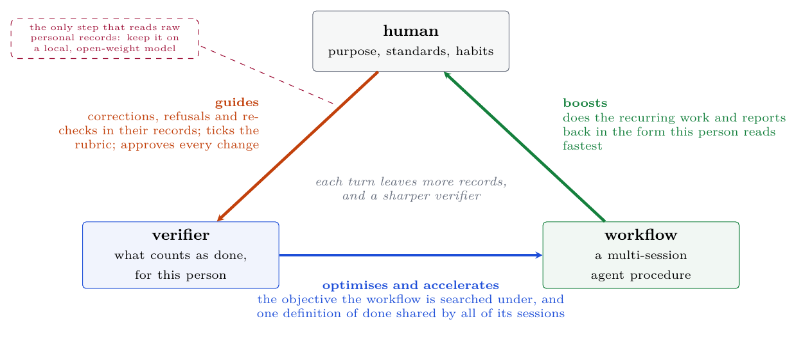
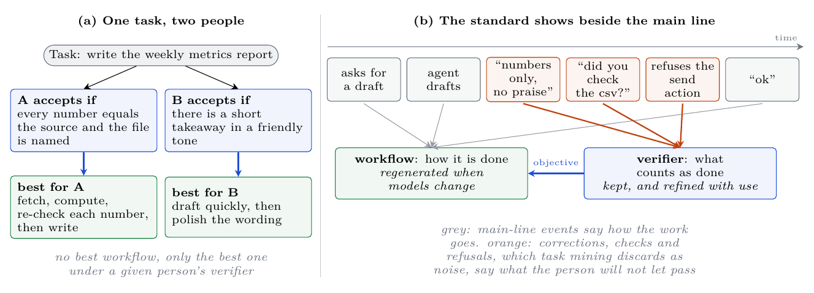
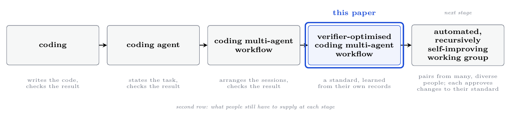
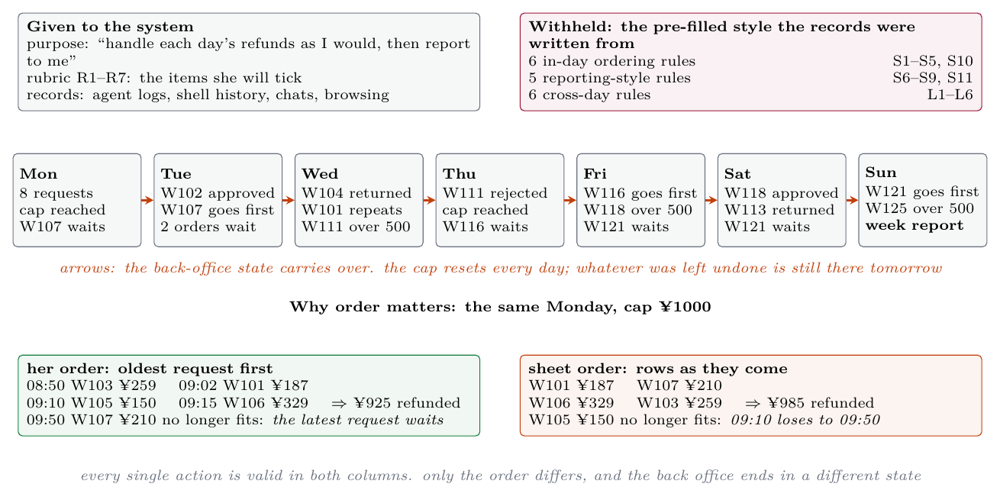

# HumanTrace2Workflow&Verifier (ht2wv)

**English** | [中文](README.zh-CN.md)

Compile a person's **(workflow, verifier)** from the access records they already have: how a recurring task is
done, and what this person accepts as done. The output is a standard Agent Skill with an executable, personal
acceptance test, usable in Claude Code or Codex.

Paper draft: [English PDF](paper/main.pdf) · [中文 PDF](paper/main_zh.pdf) · design notes (Chinese): [framework](docs/framework.md), [related work](docs/related-work.md)

## Core ideas

### 1. A triangle: human, verifier, workflow



- **The human guides the verifier.** What they correct, refuse and re-check, and what they tick on a rubric, is
  where the standard comes from. No change to it takes effect without them.
- **The verifier optimises and accelerates the workflow.** It is the objective the workflow is searched under,
  and it is attached to every agent session as the same prompt, so a long procedure can be split across sessions
  without the sessions drifting apart on what "done" means.
- **The workflow boosts the human.** It takes over the recurring work and reports back in the form that person
  reads fastest.

Without the verifier, the human has to guide the workflow directly on every run. That is prompting, and it does
not compound. With it, the person's effort goes into the standard once, and each turn of the loop leaves more
records from which to sharpen it.

### 2. The verifier is personal, and its evidence is off the main line



There is no best workflow, only the best one under a given person's verifier. The evidence for that verifier is
in what task mining throws away as noise: corrections, interruptions, re-checks, refused actions. Most of it is
already written down in the logs of the coding agents a person uses, so nothing has to be recorded.

### 3. Where this sits



coding → coding agent → coding multi-agent workflow → **verifier-optimized coding multi-agent workflow** →
automated (recursive self-improving) working group. This project implements the fourth stage.

**The next stage is about diversity.** One person's pair makes one worker in that person's image. The working
group we are aiming at is assembled from pairs distilled from many different people. Their workflows give the
group a range of procedures; their verifiers give it a range of standards that disagree in useful ways, so work
produced under one is reviewed under another. That diversity is inherited from real people rather than prompted
into existence with personas, and it stays measurable because every member's standard is an explicit, executable
object.

### 4. Only one step needs privacy

Of the three edges of the triangle, only *human → verifier* reads raw personal records. Executing a workflow sees
the task at hand; optimising it sees the verifier, which is a short, reviewable text. So the privacy requirement
falls on one step, and that step should run on a model the person hosts. The samples in this repository (records
paired with the style that produced them) are the supervision such a model needs, so the data set doubles as
training material for open-weight models that run locally (the Qwen 27B / 35B-A3B class). **This is the plan, not
a result: no open-weight model has been trained or evaluated yet, and every session reported below ran on a hosted
model.**

## What it reads

Access records are things already on the machine:

- coding-agent conversation logs (Claude Code, Codex; local and on servers)
- shell history (local and on servers)
- browser history
- exported chat logs
- recently opened files, document modification times, git commits

Screen recording and screen-video import are optional extras. Every source needs explicit consent first.

ht2wv calls no model API itself. It collects and compresses the records deterministically, then opens headless
sessions in the Claude Code / Codex you already have to do the reading and writing, and constrains what those
sessions produce with deterministic checks.

## Install

Python 3.10+. The distillation step also needs a logged-in Claude Code or Codex CLI.

```bash
git clone https://github.com/zz1358m/humantrace2workflow-verifier.git
cd humantrace2workflow-verifier
pip install -e .
ht2wv init
```

Optional: `pip install -e ".[screen]"` (live recording, Windows only), `pip install -e ".[video]"` (video import).

## Quick start

```bash
ht2wv setup
```

opens a questionnaire served on localhost only: connect your servers (key-based ssh, with a connection test),
tick which local records may be read, give paths for chat exports and work folders, then start
collect → compile → distill. Sources you did not tick are never read. The command-line equivalent is
`ht2wv sources --ask` followed by `ht2wv run --days 1`.

Step by step:

```bash
ht2wv sources                       # list sources and consent; --ask, --allow/--deny <id>, --add-host user@host
ht2wv collect allowed --days 1      # collect everything that was allowed
ht2wv compile                       # timeline + off-mainline signal candidates (no model)
ht2wv distill --top 3               # agent sessions: profile, then one skill per task (--backend claude|codex|manual)
ht2wv install <skill> --to claude   # copy a self-contained skill into ~/.claude/skills (or --to codex)
ht2wv verify <skill> --input in/ --output out/
ht2wv optimize <skill>              # freeze the verifier, improve the workflow
ht2wv shadow <skill> --input in/ --human mine/ ; ht2wv feedback <run> reject --note "..."
ht2wv evolve <skill> && ht2wv approve <skill>   # verifier changes need your approval
```

## What gets built

A skill directory holds the pair:

- **workflow**: `SKILL.md` plus `stages/01-*.md, 02-*.md, …`, one prompt per agent session. Sessions share no
  memory and hand over through files.
- **verifier**: `verifier.yaml` with items in five layers: *objective* (person-independent correctness),
  *process* (order and gating of actions, checked on the action journal), *style* (this person, across tasks),
  *preference* (this person, this task) and *report* (structure, length and readability of what is reported
  back), plus a *policy* for how this person checks. It is rendered into one `VERIFIER.md` that every session
  receives. Every personal item must cite records.

## Benchmark: samples with a hidden style

[examples/samples/](examples/samples/) holds six samples. In each, a pre-filled personal style conditions the
records and is then hidden from the pipeline.

| sample | person | task | hidden items | horizon |
|---|---|---|---|---|
| `weekly-report` | growth analyst | two csv files → report | 7 | 1 step |
| `swe-bugfix` | backend engineer | issue → fix, regression test, commit message | 7 | 1 step |
| `guest-reply` | guesthouse owner | guest message + house rules → reply | 7 | 1 step |
| `video-publish` | cooking vlogger | shoot notes → publish metadata | 7 | 1 step |
| `refund-ops` | after-sale operator | one day of refunds in a stateful back office | 11 | 1 day |
| `refund-week` | after-sale operator | seven days of refunds, state carried over | 17 | 7 days |

A sample contains: the **purpose and rubric** (visible; what the person will tick), the **style** (hidden; the
answer key), **records** rendered into each source's native format and read back by the real collectors, and a
held-out **task** with the output the person would keep (hidden).

```bash
ht2wv bench validate examples/samples/*            # every style item leaves a trace; the reference passes its own rubric
ht2wv bench prepare examples/samples/guest-reply   # render, ingest, compile; no agent
ht2wv bench run examples/samples/guest-reply --backend codex --rounds 1
ht2wv bench run examples/samples/refund-week --backend codex     # long horizon: seven days
```

Three numbers come out:

- **rubric completion**: how many rubric items the workflow's output passes. Failed items are fed back to an
  iterate session. For the week, the headline is **how many of the seven days are filled** (all applicable items pass).
- **style coverage**: for every hidden item, the reference output is broken in exactly that way; the item is
  covered if the built verifier fails the broken output on something it passes on the reference. Never fed back.
- **reference acceptance**: whether the built verifier accepts the output the person would have kept.

### The long-horizon sample



In `refund-week` every action in the back office is real, the daily refund cap makes the order of handling change
the final state, and what was left undone on one day is still there the next. Each day is graded against the
person's rules applied to the state the run itself left behind. The reference week and every process probe are
produced by actually running the back office, once by her rules and once per rule with that rule ignored.

### First results

Codex CLI, `gpt-6-astra`, `xhigh`, **one run per sample**:

| sample | rubric r0 → r1 | style coverage (checks only → with judged items) | reference accepted |
|---|---|---|---|
| weekly-report | 5/5 → 5/5 † | 6/6 → 6/6 | yes |
| swe-bugfix | 4/5 → 5/5 | 1/6 → 6/6 | **no** |
| guest-reply | 5/5 → 4/5 | 4/6 → 6/6 | **no** |
| video-publish | 5/5 → 5/5 | 5/6 → 6/6 | yes |

† first scored 2/5 because one of our rubric items wrongly required list bullets; re-scored after fixing the rubric.

What this shows so far: single-step tasks are too easy (saturated on the first run), and coverage alone is
misleading, since two of four revised verifiers reject the output the person would have kept. The `refund-week`
run is in progress. These are single runs on samples whose records we wrote ourselves, so read them as an upper
bound; there are no human participants yet.

## Privacy and cost

- Everything stays under `data/` (git-ignored). `ht2wv forget <day>` deletes a day.
- Text is redacted before storage; browser URLs keep host and path only.
- WeChat: only files you exported yourself; the local encrypted database is never read.
- Servers: key-based ssh, read-only; saved sessions and passwords of terminal apps are never read.
- **During distillation your records are read by the agent you chose, i.e. sent to that model provider.**
  `--backend manual` only writes the task briefs so you can see what would be sent.
- Claude sessions are metered in `data/ledger.jsonl` against `agent.budget_usd` (default 10). Codex does not
  report cost, so the cap does not apply to it.

## Limitations

- The Claude backend cannot be started from inside a Claude Code session; run from a normal terminal or use `--backend codex`.
- Source paths are written for Windows; live recording is Windows-only.
- Held-out material is isolated by working directory, not by an OS sandbox.

## Tests

```bash
pytest
```
