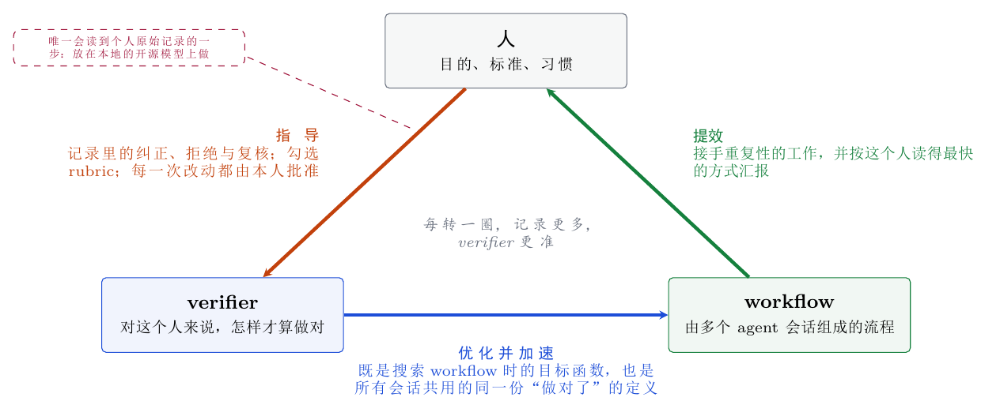
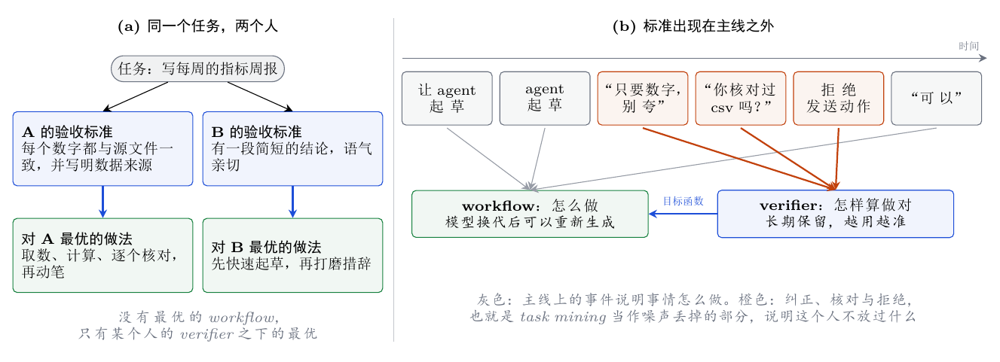
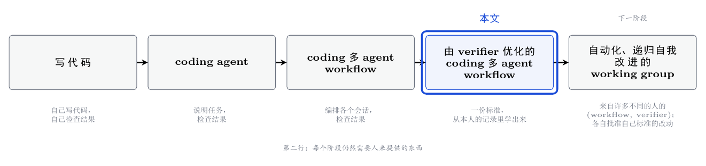
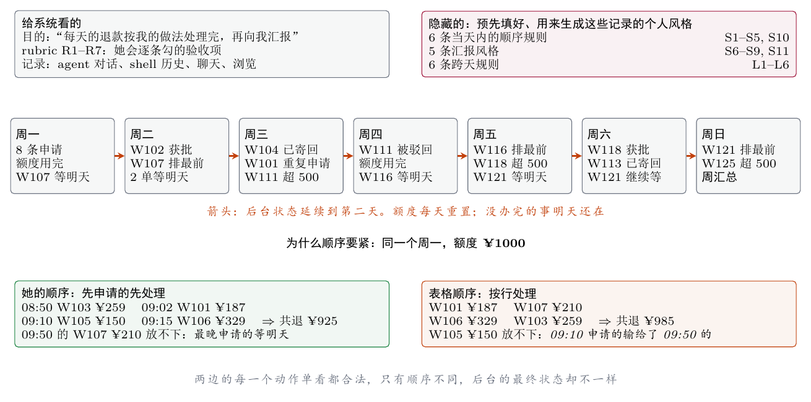

# HumanTrace2Workflow&Verifier (ht2wv)

[English](README.md) | **中文**

从一个人**已有的访问记录**里编译出 **(workflow, verifier)**：一件反复出现的事怎么做，以及这个人认为怎样才算做对。
产出是标准的 Agent Skill，自带可执行的个人验收，能装进 Claude Code 或 Codex。

论文草稿：[中文 PDF](paper/main_zh.pdf) · [English PDF](paper/main.pdf) · 设计文档：[框架](docs/framework.md)、[相关工作](docs/related-work.md)

## 核心思路

### 1. 一个三角：人、verifier、workflow



- **人指导 verifier。** 他纠正了什么、拒绝了什么、回头核对了什么、在 rubric 上勾了什么，标准就从这里来。没有他的批准，标准的任何改动都不生效。
- **verifier 优化并加速 workflow。** 它是搜索 workflow 时的目标函数；同时它作为同一份 prompt 附给每一个 agent 会话，一个很长的流程因此可以拆到多个会话里去做，而各个会话对“做对了”的理解不会走散。
- **workflow 给人提效。** 它接手重复性的工作，并按这个人读得最快的方式汇报回来。

没有 verifier，人只能直接去指导 workflow，而且每次运行都要指导一遍——那就是写 prompt，它不会累积。
有了 verifier，人的精力只在标准上花一次，此后这个循环每转一圈，都会留下更多记录，用来把标准磨得更准。

### 2. verifier 是个人的，它的证据在主线之外



没有最优的 workflow，只有某个人的 verifier 之下的最优。这个 verifier 的证据，在 task mining 当作噪声丢掉的部分：
纠正、中断、复核、被拒绝的动作。其中大部分已经写在这个人所用的 coding agent 的日志里，不需要额外录制任何东西。

### 3. 我们在哪个阶段



coding → coding agent → coding multi-agent workflow → **verifier-optimized coding multi-agent workflow** →
automated (recursive self-improving) working group。这是我们设想的发展脉络，本项目正在实现的是倒数第二个阶段。

**下一个阶段的关键是多样性。** 一个人的一对 (workflow, verifier)，只能造出一个照着这个人的样子工作的成员。
我们想要的 working group，是由从许多不同的人那里蒸馏出来的许多对组成的。他们的 workflow 给小组带来一系列不同的做法；
他们的 verifier 给小组带来一系列不同的标准，这些标准之间的分歧是有用的：在一个人的标准下做出来的东西，可以放到另一个人的标准下去审。
这种多样性是从真人那里继承来的，不是靠写 persona 的 prompt 造出来的；而且它始终可以度量，因为每个成员的标准都是一个明确的、可执行的对象。

### 4. 只有一步需要隐私

三角的三条边里，只有“人 → verifier”这一条会读到个人的原始记录。执行 workflow 看到的只是手头这件任务；
优化 workflow 看到的是 verifier，而它是一段很短的、可以审阅的文本。所以隐私要求只落在一个步骤上，这一步应该放在本人自己托管的模型上做。
本仓库里的样本（记录，配上生成这些记录的风格）正是这样的模型所需要的监督信号，所以这个数据集同时也是训练本地开源模型
（Qwen 27B / 35B-A3B 这个量级）的材料。**这是计划，不是结果：目前还没有任何开源模型在这些样本上训练或评测过，下面报告的所有会话都跑在托管模型上。**

## 读什么

访问记录指的是电脑上本来就有的东西：

- coding agent 对话日志（Claude Code、Codex，本机和服务器上的）
- shell 命令历史（本机和服务器）
- 浏览器历史
- 导出的聊天记录（微信等）
- 最近打开的文件、文档改动时间、git 提交

录屏和录屏视频导入是可选的补充。每个来源都要先明确授权。

本项目自己不调模型 API。它确定性地采集和压缩这些记录，然后在你已有的 Claude Code / Codex 里开无头会话去读、去写，
再用确定性的检查卡住这些会话的产出。

## 安装

需要 Python 3.10+；蒸馏那一步还需要本机已登录的 Claude Code 或 Codex CLI。

```bash
git clone https://github.com/zz1358m/humantrace2workflow-verifier.git
cd humantrace2workflow-verifier
pip install -e .
ht2wv init
```

可选：`pip install -e ".[screen]"`（实时录屏，仅 Windows）、`pip install -e ".[video]"`（录屏视频导入）。

## 最快的用法

```bash
ht2wv setup
```

会在浏览器里打开一个只在本机可访问的问卷页面：连接服务器（密钥 ssh，可测试连接）、勾选允许读取的本机记录、
填聊天导出和工作目录的路径，然后一键开始 采集 → 编译 → 蒸馏。没勾的来源不会被读取。
命令行等价做法是 `ht2wv sources --ask`，然后 `ht2wv run --days 1`。

分步：

```bash
ht2wv sources                       # 列出来源和授权状态；--ask 逐项询问，--allow/--deny <id>，--add-host user@host
ht2wv collect allowed --days 1      # 采集所有已授权的来源
ht2wv compile                       # 时间线 + 主线之外的信号候选（不调模型）
ht2wv distill --top 3               # agent 会话：先画像，再每个任务建一个 skill（--backend claude|codex|manual）
ht2wv install <skill> --to claude   # 把自包含的 skill 拷到 ~/.claude/skills（或 --to codex）
ht2wv verify <skill> --input in/ --output out/
ht2wv optimize <skill>              # 冻结 verifier，改进 workflow
ht2wv shadow <skill> --input in/ --human 我自己做的/ ; ht2wv feedback <run> reject --note "..."
ht2wv evolve <skill> && ht2wv approve <skill>   # verifier 的改动要你批准才生效
```

## 建出来的是什么

一个 skill 目录里放着这一对：

- **workflow**：`SKILL.md` 加 `stages/01-*.md、02-*.md……`，每个文件是交给一个 agent 会话的 prompt。会话之间不共享记忆，靠文件交接。
- **verifier**：`verifier.yaml`，条目分五层：*客观*（与人无关的正确性）、*顺序*（动作的先后与前置条件，在动作日志上检查）、
  *风格*（这个人，跨任务）、*偏好*（这个人，这个任务）、*汇报*（汇报回来的东西的结构、长度与可读性），外加一份“这个人怎么查”的 *policy*。
  它被渲染成一份 `VERIFIER.md`，每个会话都会拿到。每条个人条目都必须引用记录作为证据。

## Benchmark：带隐藏风格的样本

[examples/samples/](examples/samples/) 里有六个样本。每个样本都是先预填一份个人风格，据此写出记录，再把风格对管线隐藏。

| 样本 | 人物 | 任务 | 隐藏条目 | 时间跨度 |
|---|---|---|---|---|
| `weekly-report` | 增长分析师 | 两份 csv → 周报 | 7 | 单步 |
| `swe-bugfix` | 后端工程师 | issue → 修复、回归测试、commit message | 7 | 单步 |
| `guest-reply` | 民宿老板 | 客人消息 + 店规 → 回复 | 7 | 单步 |
| `video-publish` | 美食视频博主 | 拍摄笔记 → 发布信息 | 7 | 单步 |
| `refund-ops` | 售后运营 | 一天的退款，后台带状态 | 11 | 1 天 |
| `refund-week` | 售后运营 | 七天的退款，状态跨天延续 | 17 | 7 天 |

一个样本里有：**目的与 rubric**（可见；这个人会逐条勾的验收项）、**style**（隐藏；标准答案）、
渲染成各来源原生格式并由真实采集器读回来的 **records**，以及一个留出的 **task** 和这个人会留下的参考产出（隐藏）。

```bash
ht2wv bench validate examples/samples/*            # 每条风格在记录里有痕迹；参考产出能过自己的 rubric
ht2wv bench prepare examples/samples/guest-reply   # 只渲染、采集、编译，不启动 agent
ht2wv bench run examples/samples/guest-reply --backend codex --rounds 1
ht2wv bench run examples/samples/refund-week --backend codex     # 长程：七天
```

出三个数：

- **rubric 完成度**：workflow 的产出过了几条 rubric。没过的条目反馈给一个迭代会话。对一周的样本，主要的数字是**七天里填满了几天**（当天适用的条目全部通过）。
- **风格覆盖率**：对每条隐藏风格，把参考产出恰好在这一处改坏；如果建出来的 verifier 在某个对参考产出判通过的条目上判它不通过，这条就算被覆盖。从不反馈给管线。
- **参考产出被接受**：建出来的 verifier 接不接受这个人本来会留下的那份产出。

### 长程样本



在 `refund-week` 里，后台的每个动作都是真的，每天的退款额度让处理顺序会改变最终状态，前一天没办完的事第二天还在。
每一天都按“把她的规则用在这次运行自己留下的状态上”来评判。参考的一周和每一个顺序类探针，都是真的把后台跑一遍得到的：
一次照她的规则，然后每条规则各一次、只忽略这一条。

### 初步结果

Codex CLI，`gpt-6-astra`，`xhigh`，**每个样本只跑了一次**：

| 样本 | rubric 第 0 轮 → 第 1 轮 | 风格覆盖率（只算检查脚本 → 加上评审条目） | 参考产出被接受 |
|---|---|---|---|
| weekly-report | 5/5 → 5/5 † | 6/6 → 6/6 | 是 |
| swe-bugfix | 4/5 → 5/5 | 1/6 → 6/6 | **否** |
| guest-reply | 5/5 → 4/5 | 4/6 → 6/6 | **否** |
| video-publish | 5/5 → 5/5 | 5/6 → 6/6 | 是 |

† 最初被判为 2/5，原因是我们的一条 rubric 错误地要求列表符号；修正 rubric 后对同一份产出重新打分。

目前能说明的是：单步任务太简单（第一次执行就饱和）；只看覆盖率会被误导——四个修订后的 verifier 里有两个拒绝了这个人本来会留下的产出。
`refund-week` 还在跑。这些都是单次运行，样本里的记录是我们自己写的，所以应当把它们当作上界；目前还没有真人参与。

## 隐私与花费

- 一切在本地 `data/`（已 gitignore）。`ht2wv forget <day>` 删一天。
- 文本入库前脱敏；浏览器网址只保留域名和路径。
- 微信：只导入你自己导出的文件，不读它的本地加密数据库。
- 服务器：只走密钥 ssh、只读；不读终端软件里保存的会话和密码。
- **蒸馏时你的记录会被你选的 agent 读取，也就是发给对应的模型服务商。** `--backend manual` 只生成任务书，可以先看会发什么。
- Claude 后端的花费记在 `data/ledger.jsonl`，累计达到 `agent.budget_usd`（默认 10）就不再开新会话。Codex 不报告花费，这个上限对它不起作用。

## 已知限制

- 不能在 Claude Code 会话内部用 Claude 后端；在普通终端里运行，或用 `--backend codex`。
- 来源路径目前按 Windows 写的；实时录屏只支持 Windows。
- 对留出材料的隔离靠工作目录，不是操作系统级沙盒。

## 测试

```bash
pytest
```
